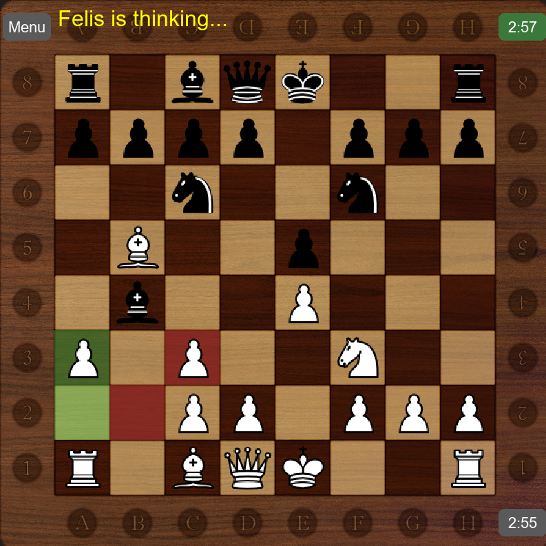
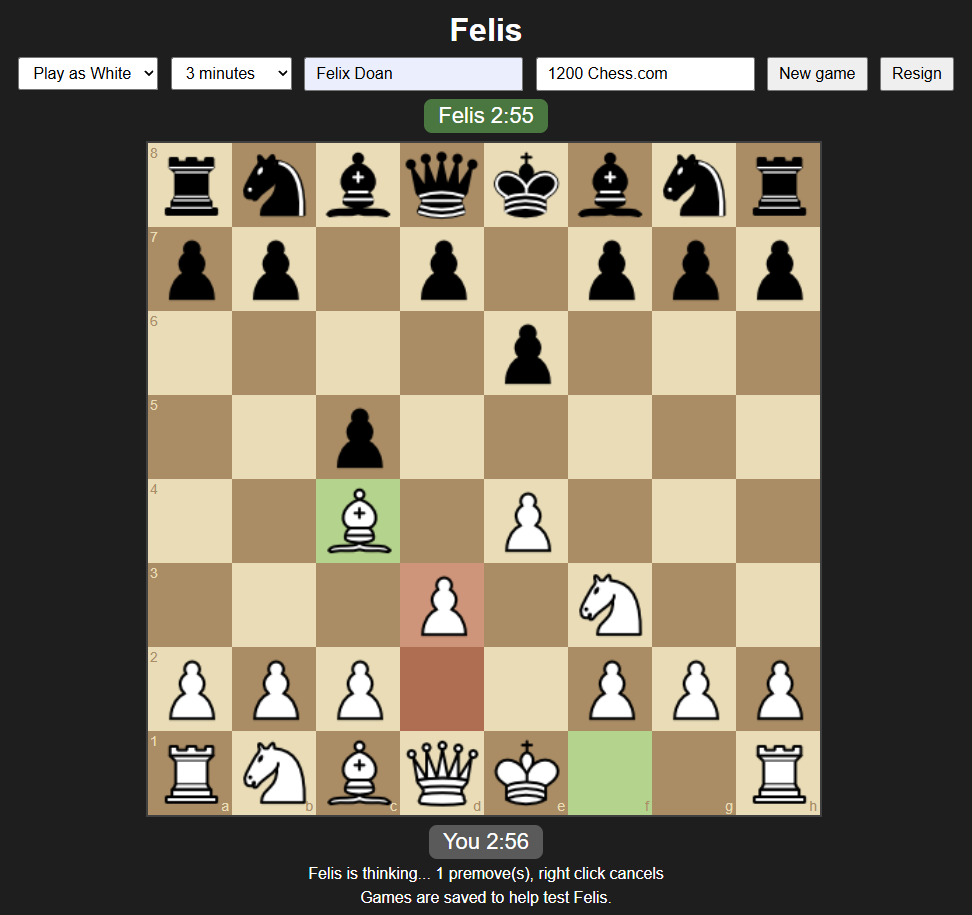

# Felis: Chess Engine & GUI


A complete chess game with a built-in chess engine, written in Python with a Pygame GUI, plus a web version you can **[play online](https://felis-97966352715.europe-west2.run.app)**. The engine uses the same core techniques as real chess engines, runs as a standard **UCI engine** (on PyPy when available), and every change to it was measured with engine-vs-engine matches before being kept. **Rated about 2140 Elo against Stockfish with a 10-minute clock** (about 2080 online).

**Highlights**
- Rated about 2140 Elo vs Stockfish (4,440 test games, 0 illegal moves)
- Every engine change measured with engine-vs-engine matches; 13 heuristics tested, 5 removed
- Playable online: FastAPI + Docker on Google Cloud Run, games saved to Cloud Storage
- Tests run automatically on every push (GitHub Actions)

| Local (Pygame) | Online (browser) |
|---|---|
|  |  |

## Play online

**[felis-97966352715.europe-west2.run.app](https://felis-97966352715.europe-west2.run.app)**: no install needed.

Built with **FastAPI** (Python server), **chessboard.js** (the board), **Docker** and **Google Cloud Run**. Each player gets their own container running Felis on PyPy, so up to about 20 people can play at once.

- Play as White or Black, with 1, 3 or 5 seconds per move, or a 3, 5 or 10-minute clock
- Premoves, resign, and the tested Elo shown next to each time option
- Every game (finished, resigned or left unfinished) is saved to **Google Cloud Storage** as JSON, so Felis can be rated against real players, e.g. the University of Bath chess club

**Felis is weaker online.** It runs on one small shared cloud CPU, a fresh container starts with an empty transposition table, and each move is capped at 5 seconds so the server isn't blocked. To play it at full strength, clone the repo and run it locally (see [Getting started](#getting-started)).

## Features

- **All FIDE rules**: castling, en passant, promotion (with a piece picker), check, checkmate, stalemate, and draws by threefold repetition, the 50-move rule and insufficient material
- **Three modes**:
  - **Player vs Player**
  - **Player vs Engine**: play as White or Black
  - **Engine vs Stockfish**: pick your engine's level and Stockfish's strength (1400 Elo up to full strength), then watch them play
- **Difficulty**: levels 1–5 (search depth 1 to 5), or **Max**, where the engine searches as deep as its time allows
- **Time controls**: a 3, 5 or 10-minute clock, or a fixed time per move (1, 5, 10, 15 or 30 seconds, a custom number of seconds, or unlimited). With a clock, the engine spends about 1/30 of its remaining time on each move. If a player's time runs out, the game is a draw if the other side can't checkmate, as in the official rules
- **Tested Elo next to each time option** at Max difficulty, taken from the rating tests below
- **Premoves**: plan your next moves while the engine is thinking; right-click to cancel
- **Opening book**: built from the [Lichess list of named openings](https://github.com/lichess-org/chess-openings) (CC0), so the engine plays real openings with some variety
- **Last move highlighted**: the squares the last move went from and to glow green
- **Engine as a separate program**: the GUI talks to the engine through the UCI protocol (the one Stockfish uses), so the engine can run on PyPy, up to 3.2× faster, while the GUI stays on normal Python

## The engine

**Search**
- Negamax with alpha-beta pruning
- Iterative deepening, with a transposition table kept between moves
- Move ordering: transposition table move, MVV-LVA captures, killer moves
- Quiescence search (with delta pruning) to avoid the horizon effect
- Check extensions, principal variation search (PVS) and late move reductions
- Time limit: plays the best move from the deepest search completed

**Evaluation**: a tapered evaluation, blending middlegame and endgame values as pieces come off. It started with 13 heuristics, with every value taken from established engines and literature rather than invented.

Each heuristic was tested by playing the full engine against the same engine without that one heuristic: 500 games at depth 2 and 200 games at depth 3. Elo above 0 means the heuristic makes the engine stronger. All 13 together are worth **+548 Elo** at depth 2 and **+798 Elo** at depth 3, compared with no heuristics at all.

| Heuristic | What it does | Source | Elo (depth 2) | Elo (depth 3) | Kept? |
|---|---|---|---|---|---|
| King endgame table | brings the king to the centre in the endgame | Tomasz Michniewski | +51 | +89 | yes |
| Pawn structure | penalises doubled and isolated pawns, rewards passed pawns | Fruit 2.1 | +41 | +31 | yes |
| Mobility | rewards pieces that have more moves | Fruit 2.1 | +36 | +21 | yes |
| King pawn shield | rewards pawns in front of the castled king | Fruit 2.1 | +34 | +16 | yes |
| Bishop pair | bonus for keeping both bishops | Larry Kaufman | +21 | −3 | yes |
| Piece-square tables | a value for every piece on every square | Tomasz Michniewski | +17 | +65 | yes |
| King attack | penalises enemy pieces aimed at the squares around the king | Fruit 2.1 | +11 | −10 | yes |
| Mop-up | in won endgames, drives the losing king to the edge | Chess 4.x (Slate & Atkin) | +2 | 0 | yes |
| Hanging pieces | penalises pieces that are attacked and not defended | Stockfish 11 | +7 | 0 | removed |
| Knight outposts | bonus for a knight defended by a pawn where no enemy pawn can attack it | Toga | +6 | −16 | removed |
| Bishop outposts | the same for a bishop, in the endgame only | Stockfish 11 | −3 | +5 | removed |
| Rooks on open files | bonus for a rook on a column with no pawns of its own colour | Fruit 2.1 | −9 | −12 | removed |
| Centre control | bonus for each centre square a piece controls | Lyudmil Tsvetkov (Little Chess Evaluation Compendium) | −40 | −49 | removed |

Small numbers (roughly under ±20) are too close to tell apart from luck in this many games. Centre control was the only heuristic that clearly made the engine weaker.

The 5 removed heuristics were then tested together in 1,000 games at depth 3. Together they added only +10 Elo, too small to tell apart from luck, and the engine was **16% faster** without them, so they were removed.

## How changes were tested

Every engine change was checked with engine-vs-engine matches: both versions play the same openings, each played twice with colours swapped, using the same statistics as Stockfish's testing framework (Fishtest).

| Change | Test | Result |
|---|---|---|
| Move ordering, transposition table, iterative deepening | 200 games + timing | 2.4× faster at depth 5, no loss in strength |
| Quiescence search | 200 games vs the old engine searching one move deeper | **+288 Elo**, using 44% less time |
| In-check quiescence + check extension | 200 games, same depth | **+149 Elo** |
| Captures-only legality checks + delta pruning | 200 games + timing | 1.4–1.6× faster, same strength |
| Principal variation search | 200 games + timing | 5–13% faster, same moves |
| Late move reductions | 800 games at 1 second per move | about +19 Elo, 2.25× faster at depth 5 |
| Null-move pruning | 400 games (same depth and same time) | no gain at this depth, so **removed** |
| Running on PyPy | timing on 36 searches | up to 3.2× faster, identical moves |
| Keeping the transposition table between moves | timing + 100 games | 1.3× faster, no loss in strength |
| Texel tuning of 25 numbers (187k positions from 20,000 self-play games) | 400 games at 1 second per move | **−51 Elo**, so not used |

## Rating

Felis played **4,440 rated games against Stockfish 19**, capped at 1500, 1750, 2000 and 2250 Elo: 3,000 locally (on PyPy) and 1,440 against the live website. python-chess refereed every move: **0 illegal moves**.

Ratings are on Stockfish's capped-Elo scale, which is anchored to the **CCRL** engine rating list, not chess.com or FIDE.

**How the rating is calculated:** Felis's points are added up (win = 1, draw = ½). The **Calculated** rating is the one that, by the Elo formula, would be expected to score exactly those points against the same Stockfish opponents. **Likely range** shows how far luck could have moved that score: it's measured from how much each opening's pair of games varies, and turned into the lowest and highest ratings it could mean. More games give a narrower range.

**Why each test exists**

| Test | What it shows |
|---|---|
| Random openings, book off | strength across many different positions; the standard way engines are rated (fairest to compare with other engines) |
| Starting position, book off | how well Felis plays openings by its own search; the baseline for judging the book |
| Starting position, book on | the strength people actually face when they play it (full final strength) |
| Local vs web | what running on a small cloud CPU costs it (a real deployment trade-off) |

**Random openings, book off**

| Where | Time per move | Games | Likely range | Calculated Rating |
|---|---|---|---|---|
| Local | 1 second | 400 | 1681–1768 | 1725 |
| Local | 5 seconds | 200 | 1859–1987 | 1922 |
| Local | 10 seconds | 200 | 1898–2038 | 1967 |
| Web | 1 second | 120 | 1634–1821 | 1730 |
| Web | 3 seconds | 120 | 1766–1928 | 1847 |
| Web | 5 seconds | 120 | 1875–2015 | 1945 |

**Starting position, book off**

| Where | Time per move | Games | Likely range | Calculated Rating |
|---|---|---|---|---|
| Local | 1 second | 400 | 1697–1788 | 1743 |
| Local | 5 seconds | 200 | 1816–1945 | 1881 |
| Local | 10 seconds | 200 | 1915–2048 | 1981 |
| Web | 1 second | 120 | 1736–1892 | 1815 |
| Web | 3 seconds | 120 | 1882–2036 | 1959 |
| Web | 5 seconds | 120 | 1791–1959 | 1875 |

**Starting position, book on (full strength)**

| Where | Time | Games | Likely range | Calculated Rating |
|---|---|---|---|---|
| Local | 1 second per move | 400 | 1771–1859 | 1815 |
| Local | 5 seconds per move | 200 | 1915–2043 | 1978 |
| Local | 10 seconds per move | 200 | 1999–2120 | 2059 |
| Local | 3-minute clock | 200 | 1961–2082 | 2021 |
| Local | 5-minute clock | 200 | 1976–2121 | 2047 |
| Local | 10-minute clock | 200 | 2083–2202 | **2141** |
| Web | 1 second per move | 120 | 1768–1907 | 1838 |
| Web | 3 seconds per move | 120 | 1916–2079 | 1996 |
| Web | 5 seconds per move | 120 | 1863–2009 | 1935 |
| Web | 3-minute clock | 120 | 1938–2116 | 2025 |
| Web | 5-minute clock | 120 | 1910–2095 | 2001 |
| Web | 10-minute clock | 120 | 1998–2164 | 2078 |

The web tests used fewer games, so their ranges are wider. Where a longer time scores lower (e.g. web 3 s vs 5 s), the ranges overlap, so the difference is just luck. Stockfish's capped levels don't fully agree with each other, so treat every rating as approximate. The engine gains much more from extra thinking time than capped Stockfish does, so longer time controls favour it. In 600 local clock games, Felis never ran out of time; Stockfish did 56 times.

## Getting started

Requires Python 3.11 (other recent versions should work).

```bash
git clone https://github.com/FelixDoan2005/gui-chess-engine.git
cd gui-chess-engine
pip install -r requirements.txt
python main.py
```

**Optional (recommended): run the engine about 3× faster with [PyPy](https://pypy.org).** If `pypy3` or `pypy` is on your PATH, the game uses it automatically; otherwise set `PYPY_PATH` to the PyPy executable. Without PyPy, it runs on normal Python.

**For Engine vs Stockfish**, download [Stockfish](https://stockfishchess.org) and either put it on your PATH as `stockfish`, or set `STOCKFISH_PATH` to it.

**To run the web version on your own computer:**

```bash
pip install -r web/requirements.txt
fastapi run web/server.py
```

Then open http://localhost:8000. Games are only saved when the server can reach the Cloud Storage bucket; otherwise everything else works as normal.

## Running the tests

The unit tests run automatically on every push with **GitHub Actions**.

```bash
pip install -r requirements-dev.txt
python -m pytest                                   # 46 unit tests: rules, search, evaluation and UCI
python tests/matches/all_heuristics_test.py        # how much each heuristic adds (runs for hours, on all CPU cores)
python tests/matches/simplification_test.py        # checks removing heuristics doesn't cost strength
```

**Rating vs Stockfish** (needs Stockfish, as above):

```bash
python tests/matches/stockfish_rating_test.py 10 25 book
```

The three settings, in order:

| Setting | Example | Meaning |
|---|---|---|
| Time | `10` or `5m` | seconds per move, or a clock in minutes when it ends in `m` |
| Openings per level | `25` | each opening is played twice (colours swapped) against 4 Stockfish levels, so 25 = 200 games |
| How games start | `book` | `random` = random 4-move openings, book off; `start` = starting position, book off; `book` = starting position, book on |

**Rating of the live website:**

```bash
python tests/matches/web_rating_test.py 3 15 10 book
```

The same settings, plus the number of games played at once (`10`) before how the games start.

Every result above is saved in `tests/results/`.

## Project structure

```
main.py                       game loop and screens (talks to the engines through UCI)
engine/uci.py                 the UCI engine program
engine/ai.py                  search and evaluation
engine/book.json              the opening book
engine/build_book.py          builds the book from the Lichess openings list
ui/chess_logic.py             board, move generation and rules
ui/renderer.py                drawing the board and menus
web/server.py                 FastAPI server: Felis's moves and game saving
web/index.html                the web page (chessboard.js)
Dockerfile                    the container that runs on Google Cloud Run
.github/workflows/tests.yml   runs the unit tests on every push
tests/                        unit tests (pytest)
tests/matches/                engine-vs-engine and rating tests
tests/results/                every test result (ratings in tests/results/ratings/local and web)
```
